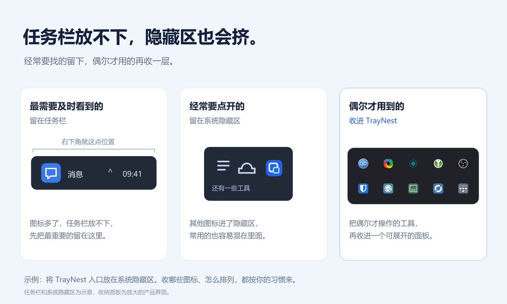

# TrayNest · 托盘收纳盒

**隐藏图标太多？不常用的，再收一层。**

任务栏右下角就那么点位置，得先留给最重要的图标。需要及时看到的消息、经常留意的状态，已经占去了不少地方，其他图标就收进了系统的“隐藏的图标”面板。

进了隐藏区，使用频率的差别还在：有的工具经常要点开，有的只在改设置、处理文件时才碰一次。全放在同一个面板里，常用和不常用的又挤在了一起。

TrayNest 是一个 Windows 11 托盘图标收纳工具。它给系统隐藏区再加一个可以展开的收纳盒：经常要找的留在原处，偶尔才操作的拖进去，再收一层。任务栏留给最重要的，隐藏区里的常用图标也更容易找到。

[下载预览版](https://github.com/Wuyuhang0729/traynest/releases)

宣传图展示当前源码开发版，公开下载包的功能以 Release 说明为准。

## 经常用的少翻找，偶尔用的不占地方

任务栏的位置有限，可以优先留给需要及时看到的消息和状态；经常操作的工具留在系统隐藏区，偶尔才点的收进 TrayNest。哪些放在哪，按你自己的用法安排。

## 功能

- 拖拽收纳托盘图标，拖出面板即可移回。
- 支持已收纳图标的单击、双击和右键菜单。
- 记住收纳规则，启动后自动收纳。
- 保存用户排好的图标顺序与每行列数；工具退出或晚启动时仍保留原格位。
- 面板内按住左键即可重新排序，图标平滑换位并显示目标位置，松手保存，Esc 取消；拖动时保持普通箭头，不显示悬浮重复图标。
- 未运行或暂未找到托盘图标的工具以淡色显示。单击尝试启动，右键可设置启动文件或移出收纳；支持普通 EXE 和快捷方式，无法可靠启动时给出提示。
- 可选开机启动，正常退出时恢复原图标。
- 面板按图标数量调整大小，支持圆角悬停高亮、上滑展开和下沉关闭动画。
- 入口右键菜单可选择面板在左侧或上方展开，位置偏好会保存。

## 选择展开位置

右键 TrayNest 托盘入口，选择 **弹出位置 → 左侧／上方**。系统隐藏区展开时以隐藏区为参照；入口直接放在任务栏时，以入口为参照。靠近屏幕边缘时自动避让。

## 运行要求

- Windows 11 x64。
- 新版完整包自带 **.NET 10 LTS** 运行时，解压即可运行。

目前仅在 Windows 11 25H2 上完成实机验证，其他系统版本和显示配置仍需测试。

## 使用方法

1. 解压完整程序包，运行 `NestedTray.exe`。
2. 在系统托盘中找到蓝色嵌套方框图标，点击打开收纳面板。
3. 从 Windows 的“隐藏的图标”区域拖入需要收纳的图标。
4. 点击或右键已收纳图标，使用对应软件的功能；拖出面板可取消收纳。
5. 入口悬停显示“TrayNest · 托盘收纳盒”。右键入口可设置开机启动、“移回全部并清空收纳…”或退出。清空需确认，会删除收纳列表、排序和启动文件设置；“退出”会恢复图标并保留布局。
6. 在收纳面板中拖动图标可保存排序；入口菜单“每行图标数”可选择固定 5–8 列。开机启动恢复的是 TrayNest 的布局，没有自启动的软件仍以淡色保留，按需点击启动。

旧版仅保存了收纳列表，第一次升级时会据此建立布局；旧版未写入磁盘的拖拽顺序无法还原。升级后重新排好一次即可保存。

## 问题反馈

发生错误时，提示会显示固定错误编号（例如 `TN3001`）和事件 ID。右键入口选择 **“诊断与反馈…”**，可复制或导出报告，再点击“打开 GitHub 反馈”填写复现步骤。

报告包含程序版本、系统环境、错误调用栈和托盘状态计数，会过滤用户名、完整路径、图标提示及窗口标题。请检查后再提交。日志保存在 `%LOCALAPPDATA%\NestedTray\logs`，自动限制大小；报告由用户主动提交。

[提交问题](https://github.com/Wuyuhang0729/traynest/issues/new?template=bug_report.yml) · [错误编号说明](docs/ERROR_CODES.md) · [从源码构建](BUILDING.md)

## 当前状态

项目处于预览阶段，欢迎反馈问题。

- 部分图标拖动时仍可能显示禁止标志，但松手后可以收纳。
- 部分软件图标暂时无法收纳，例如目前测试中的英伟达托盘图标。
- 托盘适配使用了未公开的 Windows 消息格式，Windows 更新可能影响兼容性。
- 尚未验证全部第三方软件、多显示器和不同缩放比例下的行为。

## 许可证

[MIT License](LICENSE)

宣传图中的工具图标为公开演示素材，属于各自作者，不代表合作或全部兼容认证。图片、可编辑图层及素材来源见 [宣传图说明](promo/readme/CREDITS.md)。
