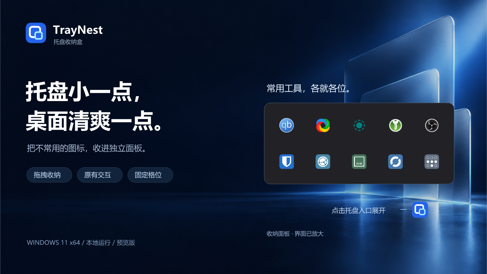
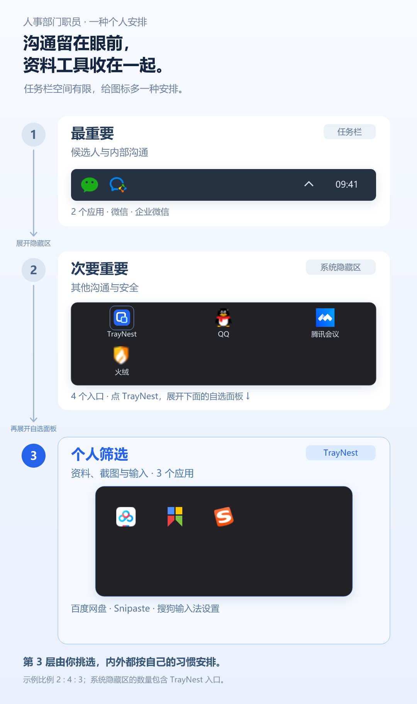
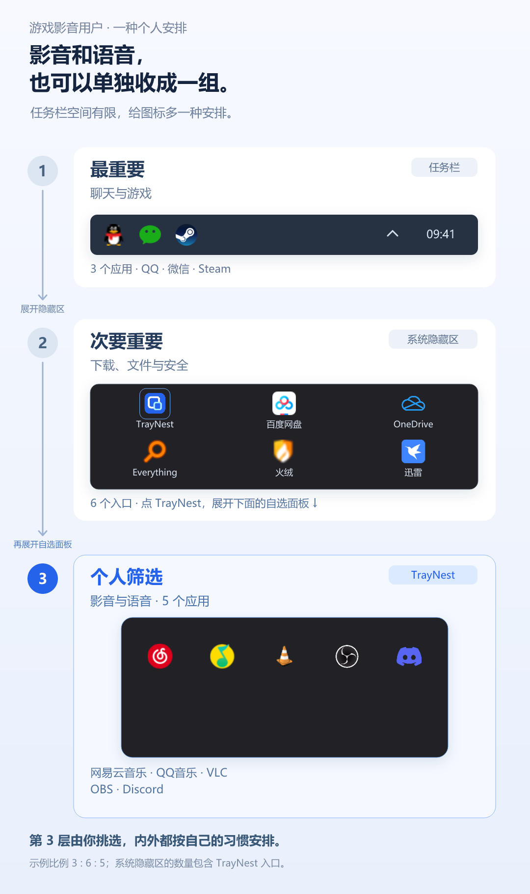
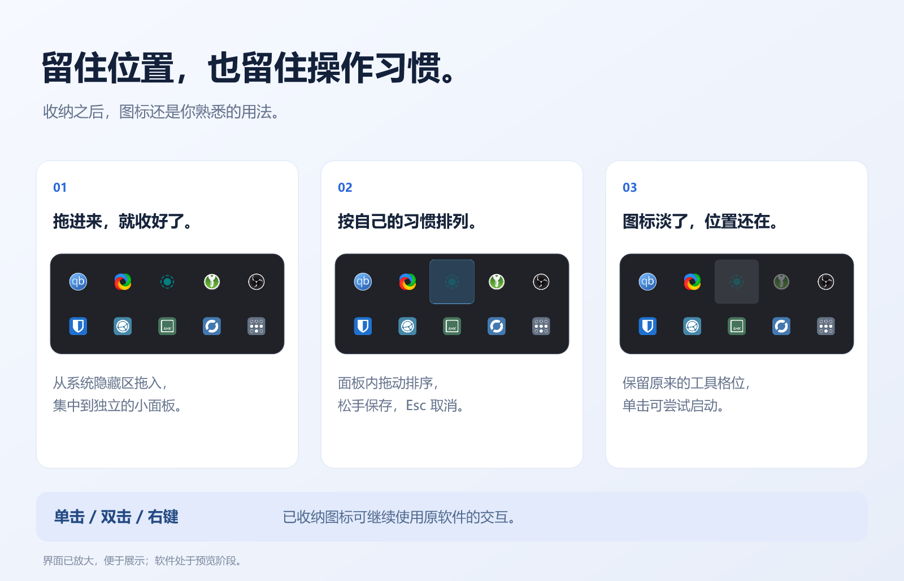
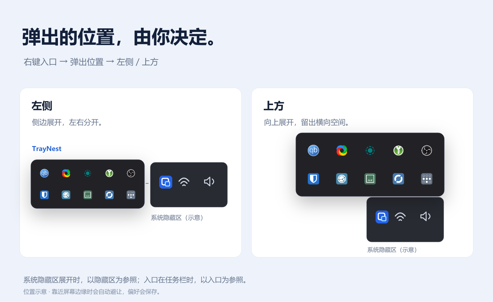

# TrayNest · 托盘收纳盒

任务栏右下角的位置有限，通常只能留给最重要的几个图标。其余应用挤进系统隐藏区，消息、网盘、安全软件和各种后台工具又混在了一起。

TrayNest 是一个 Windows 11 托盘图标收纳工具。你可以从隐藏区里再挑出一组图标，放进独立面板，需要时再展开。

比如，把消息留在任务栏，同步和安全软件留在系统隐藏区，开发工具集中放进 TrayNest。也可以换成影音、文件传输，或是平时很少点击的图标。三个位置分别放什么，按自己的习惯来。

[下载预览版](https://github.com/Wuyuhang0729/traynest/releases) · [安装与使用](#安装与使用) · [提交问题](https://github.com/Wuyuhang0729/traynest/issues/new?template=bug_report.yml)

当前预览版：`0.2.0-preview.10`。其他版本的功能和安装方式见对应 Release 说明。

## 使用案例

下面是三种安排，供你参考。图标需要手动选入，每个案例都只有一个收纳面板。

### 程序员：开发工具收在一起，消息留在外面

QQ、微信和腾讯会议放在任务栏，方便关注工作消息。同步、安全和远程连接软件留在系统隐藏区，Docker、PowerToys 等开发与排障工具收进 TrayNest。

<strong>人事部门职员：沟通留在眼前，资料工具收在一起</strong>

微信和企业微信放在任务栏，QQ、会议和安全软件留在系统隐藏区。百度网盘、截图工具和不常点击的输入法设置收进 TrayNest，处理资料时再打开。

<strong>游戏影音用户：影音和语音，也可以单独收成一组</strong>

聊天软件和游戏平台放在任务栏，下载、文件和安全软件留在系统隐藏区。音乐、播放、录制和语音软件集中收进 TrayNest。

## 收进去，还是熟悉的用法

| 功能 | 实际操作 |
| --- | --- |
| 收纳与移回 | 从系统隐藏区拖入面板；拖出面板即可移回 |
| 使用原软件 | 支持已收纳图标的单击、双击和右键菜单 |
| 排好顺序 | 面板内拖动排序，松手保存，Esc 取消；支持固定 5–8 列 |
| 记住位置 | 启动后按规则收纳；软件退出或晚启动时，原位置会留一个淡色图标 |
| 按需启动 | 单击淡色图标尝试启动，面板会显示等待或失败状态；右键可设置 EXE 或快捷方式 |
| 选择弹出位置 | 入口右键 → **弹出位置 → 左侧／上方**。设置会保存，靠近屏幕边缘时自动避让 |
| 选择面板外观 | 入口右键 → **面板外观 → 亚克力／浅色／深色／跟随系统托盘**。选择会保存；默认跟随 Windows 系统托盘的浅深色模式 |
| 退出与开机启动 | 正常退出会恢复原图标并保留布局；需要开机启动时，可以自行开启 |

查看收纳、排序与弹出位置示意

## 安装与使用

需要 Windows 11 x64。完整包自带 .NET 10 运行时，不用另外安装 .NET。

1. 下载并**完整解压**程序包。
2. 双击 **`Install.cmd`**。安装后会在桌面创建带 TrayNest 图标的快捷方式，以后从桌面打开即可。
3. 在系统隐藏区找到蓝色嵌套方框图标，点击打开面板，把想收纳的图标从隐藏区拖进来。
4. 点击或右键图标使用原软件；拖动调整顺序，拖出面板取消收纳。

程序默认安装到当前用户的 `%LOCALAPPDATA%\Programs\TrayNest`，不会自动开启开机启动。更新前先右键 TrayNest 入口，选择“退出”，再安装新包。原来的收纳布局和启动文件设置会保留。

也可以不安装，直接运行 `NestedTray.exe`；没有 `Install.cmd` 的旧包也这样打开。便携使用时，在解压目录运行 `Create-DesktopShortcut.ps1` 可以单独创建桌面快捷方式。请保留程序所在的文件夹，否则快捷方式会失效。

移回全部、旧版升级与开机启动

- **退出**：恢复原图标，保留收纳列表和布局。
- **移回全部并清空收纳…**：确认后恢复图标，同时删除收纳列表、排序和启动文件设置。
- **开机启动**：只启动 TrayNest。其他软件如果没有启动，面板里会保留淡色图标，需要时点击尝试启动。
- 旧版只保存收纳列表，升级时会用这份列表建立布局。旧版没有保存的排序，需要重新调整一次。

## 预览版说明

目前仅在 **Windows 11 25H2** 上完成实机验证。

- 部分图标拖动时可能显示禁止标志，但松手后可以收纳。
- 部分软件图标暂时无法收纳，例如目前测试中的英伟达托盘图标。
- 托盘适配使用未公开的 Windows 消息格式，系统更新可能影响兼容性。
- 尚未验证全部第三方软件、多显示器和不同缩放比例。

案例图只演示手动选择后的收纳方式，不代表图中的第三方软件都已通过兼容性测试。详见 [兼容性说明](docs/COMPATIBILITY.md)。

## 遇到问题

右键 TrayNest 入口，选择 **诊断与反馈…**，可以复制或导出报告。提交时请附上复现步骤，以及错误提示中的编号（如 `TN3001`）和事件 ID。

报告会过滤用户名、完整路径、图标提示和窗口标题，由你检查后主动提交。日志保存在 `%LOCALAPPDATA%\NestedTray\logs`，程序会限制日志大小。

[提交问题](https://github.com/Wuyuhang0729/traynest/issues/new?template=bug_report.yml) · [错误编号](docs/ERROR_CODES.md) · [从源码构建](BUILDING.md)

## 许可证与素材

代码使用 [MIT License](LICENSE)。演示软件名称和图标属于各自作者，不代表合作或兼容认证。图片、可编辑图层与来源见 [宣传图说明](promo/readme/CREDITS.md)。
