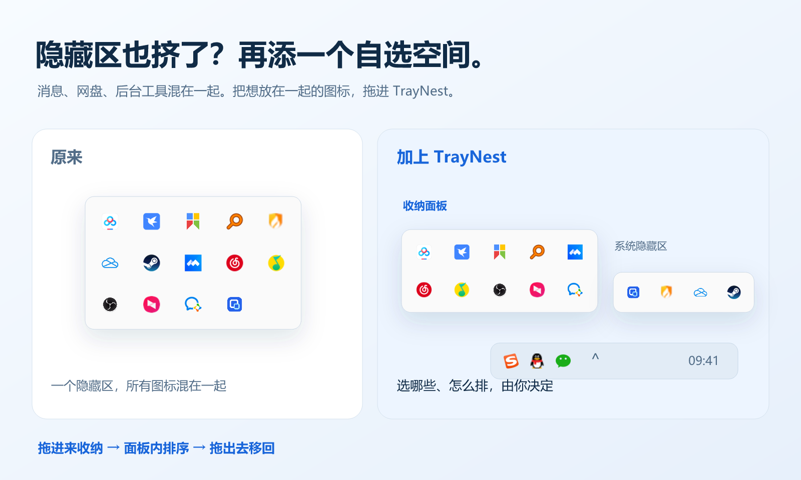
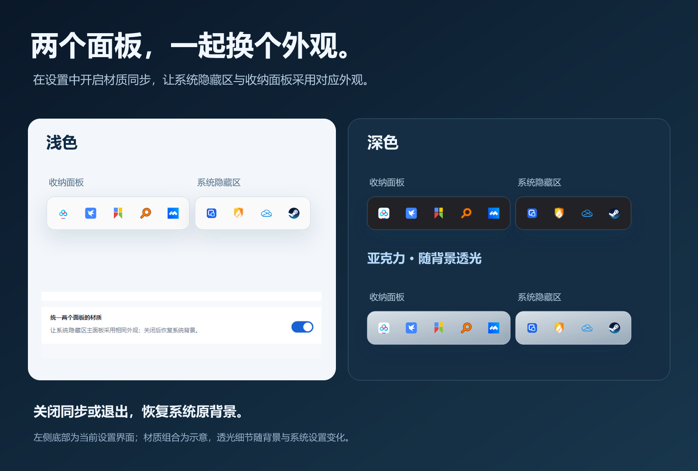

# TrayNest · 图标面板管理工具

任务栏右下角的位置有限，系统隐藏区也会挤满图标。临时打开一个应用、退出再重开，或随手拖动一次，熟悉的入口就可能换个位置。

TrayNest 为 Windows 11 增加一个独立收纳面板。把想放在一起的图标从隐藏区拖进来，按自己的习惯排好，需要时再展开。

**[下载 preview.12](https://github.com/Wuyuhang0729/traynest/releases/tag/v0.2.0-preview.12)** · [安装与使用](#安装与使用) · [更新说明](docs/RELEASE-0.2.0-preview.12.md) · [提交问题](https://github.com/Wuyuhang0729/traynest/issues/new?template=bug_report.yml)

## 多一个空间，自己决定怎么放

常用入口继续留在任务栏。其余图标，可以留在系统隐藏区，也可以挑进 TrayNest。选哪些、怎么排，由你决定。

从系统隐藏区**拖入收纳**，在面板内**拖动排序**，拖出面板即可**移回**。已收纳图标继续支持原软件的单击、双击和右键菜单。

## 重启电脑，布局不变

TrayNest 会保存收纳项目和顺序。软件尚未启动时，原位置保留淡色图标；点击可尝试打开，也能为它指定 EXE 或快捷方式。

展开方式在“设置 → 常规”中三选一：**手动展开、跟随系统隐藏区、悬停入口**。两种自动模式互斥；拖动图标靠近入口时，仍会自动展开，方便放入。

## 两个面板，外观也能统一

在“设置 → 面板”选择**亚克力、浅色、深色或跟随系统托盘**。打开“统一两个面板的材质”，系统隐藏区也会采用对应外观；同步开启时，“跟随系统托盘”让两个面板使用随系统明暗变化的亚克力。

关闭同步或退出 TrayNest 后恢复系统原背景。功能自带原生桥接组件，无需另外安装 Windhawk。

右键 TrayNest 入口只保留“设置”，打开独立窗口后集中调整：

| 设置 | 用法 |
| --- | --- |
| 展开位置 | 选择系统隐藏区左侧或上方；分别按底部、左侧对齐，靠近屏幕边缘时自动避让 |
| 每行图标数 | 固定 5–8 列，按图标数量和屏幕空间调整 |
| 开机启动 | 登录 Windows 后运行 TrayNest，默认关闭；其他软件的启动方式仍由它们自己决定 |
| 打开与刷新 | 在常规页打开收纳面板，或重新获取正在运行的软件图标 |
| 移回全部 | 在面板页确认后恢复图标，并清空保存的收纳项目、排序和启动文件设置 |
| 正常退出 | 设置窗口左下方“退出 TrayNest”；恢复原图标和系统背景，保留收纳布局 |

## 安装与使用

需要 **Windows 11 x64**。完整包自带 .NET 10 运行时，不用另外安装 .NET。

1. 在 [Release 页面](https://github.com/Wuyuhang0729/traynest/releases/tag/v0.2.0-preview.12) 下载 ZIP，**完整解压**。
2. 双击 **`Install.cmd`**。安装后会创建带正式图标的桌面快捷方式，以后从桌面打开即可。
3. 点开系统隐藏图标区，找到蓝色嵌套方框图标，打开 TrayNest。
4. 把想收纳的图标拖进面板，拖动调整顺序；右键入口打开设置。

程序默认安装到当前用户的 `%LOCALAPPDATA%\Programs\TrayNest`，不会自动开启开机启动。更新前先打开设置，点击左下方“退出 TrayNest”，再安装新包；已有布局和启动文件设置会保留。

也可以不安装，直接运行解压目录中的 `NestedTray.exe`。请保留整个文件夹，尤其是 `native/` 材质组件。便携使用时，运行同目录的 `Create-DesktopShortcut.ps1` 可单独创建快捷方式。

## 预览版说明

目前仅在 **Windows 11 25H2** 上完成实机验证。

- 部分图标拖动时可能显示禁止标志，但松手后可以收纳。
- 部分软件图标暂时无法收纳，例如目前测试中的英伟达托盘图标。
- 托盘适配和原生背景控件依赖 Windows 内部实现，系统更新可能影响兼容性。
- 主面板材质同步可能与任务栏美化工具冲突；连接失败时会提示并保留原设置。两个面板使用不同绘制技术，透光细节可能略有差别。
- 尚未覆盖所有第三方软件、多显示器、缩放比例和长期睡眠唤醒场景。

宣传图使用公开软件图标和隔离演示界面，系统隐藏区与材质组合包含示意层，不代表图中所有软件都已通过兼容性测试。详见 [兼容性说明](docs/COMPATIBILITY.md)。

## 遇到问题

右键入口，打开 **设置 → 关于 → 诊断与反馈**，可以复制或导出报告。提交时请附上复现步骤，以及错误提示中的编号（如 `TN3001`）和事件 ID。

报告会过滤用户名、完整路径、图标提示和窗口标题，由你检查后主动提交。日志保存在 `%LOCALAPPDATA%\NestedTray\logs`，程序会限制日志大小。

[提交问题](https://github.com/Wuyuhang0729/traynest/issues/new?template=bug_report.yml) · [错误编号](docs/ERROR_CODES.md) · [从源码构建](BUILDING.md)

## 许可证与素材

代码使用 [MIT License](LICENSE)。演示软件名称和图标属于各自作者，不代表合作或兼容认证。新版宣传页、可编辑图层、背景提示词与来源见 [制作说明](promo/readme/v2/CREDITS.md)；[旧版素材](promo/readme/CREDITS.md)保留归档。
