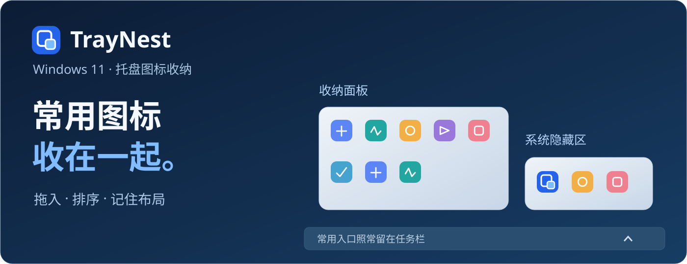
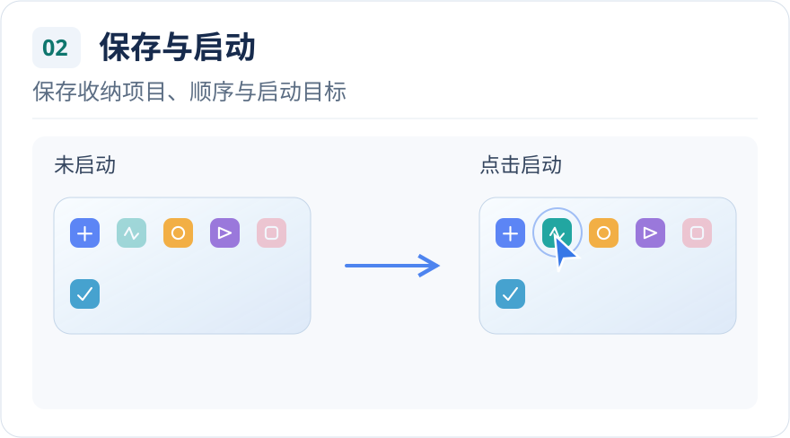
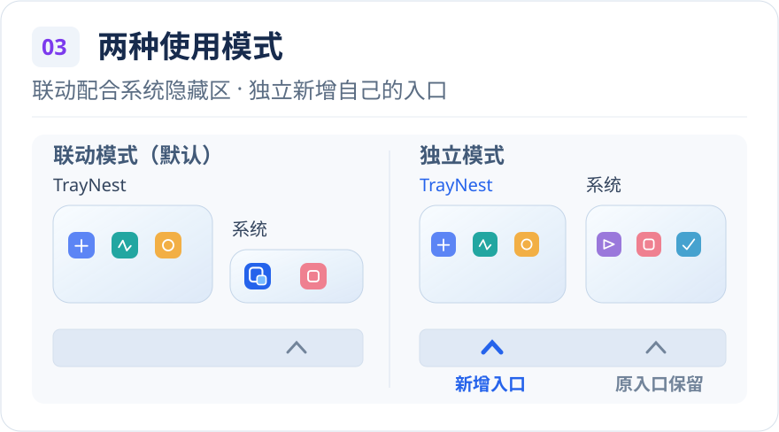
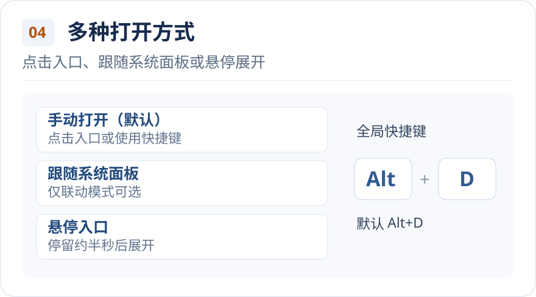
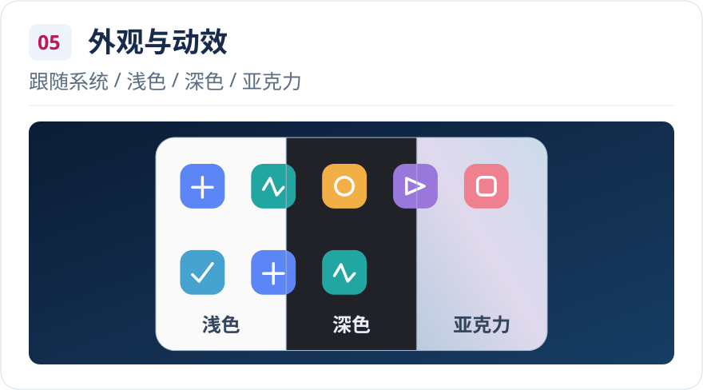

# TrayNest · 托盘图标收纳工具

> **隐藏与整理 · 保存与启动 · 两种使用模式** 
> **多种打开方式 · 外观与动效**

**[下载预览版](https://github.com/Wuyuhang0729/traynest/releases/tag/v0.2.0-preview.17)** · [使用指南](docs/USER_GUIDE.md) · [更新日志](CHANGELOG.md)

## 重要功能

 

 

## 全部功能

| 类别 | 功能 |
| --- | --- |
| 收纳 | 拖入 · 排序 · 拖出 · Esc 取消 · 全部移回 |
| 记忆与启动 | 布局记忆 · 离线占位 · 点击尝试启动 · 指定 EXE / 快捷方式 |
| 原软件交互 | 单击 · 双击 · 右键菜单 |
| 面板模式 | 独立：新增蓝箭头，保留系统入口；联动：配合系统隐藏区；共用布局 · 分别记住入口位置 |
| 自动展开 | 联动：手动 / 跟随 / 悬停；独立：手动 / 悬停；跟随：同时 / 先后 |
| 快捷入口 | Alt+D（可改 / 清除）· 仅收纳 / 两面板 · 空白格双击（仅联动，默认关闭）|
| 位置与布局 | 联动：左侧 / 上方；独立：入口上方居中；每行 5–8 个图标 |
| 主题与材质 | 窗口：浅色 / 深色 / 系统；面板：系统 / 亚克力 / 浅色 / 深色；背景同步 |
| 更新 | 手动检查 · 自动检查 · 独立重要提醒 · 下载校验 · 用户确认安装 |
| 安装与恢复 | 安装 / 便携 · 保留配置 · 退出恢复 · 失败回退 · 卸载保留配置 |
| 辅助 | 开机启动 · 刷新图标 · 脱敏诊断 |

[全部功能独立文档](docs/FEATURES.md) · [操作指南](docs/USER_GUIDE.md)

## 安装与上手

需要 **Windows 11 x64** 和 **WebView2 Runtime**。自带 .NET 10，无需另装 .NET；缺少 WebView2 时按向导提供的微软入口手动安装。

- **推荐安装**：[下载安装器 EXE](https://github.com/Wuyuhang0729/traynest/releases/download/v0.2.0-preview.17/TrayNest-Setup-v0.2.0-preview.17-win-x64.exe)，按向导操作。
- **完整 ZIP / 便携使用**：[下载 ZIP](https://github.com/Wuyuhang0729/traynest/releases/download/v0.2.0-preview.17/TrayNest-v0.2.0-preview.17-win-x64.zip)，完整解压后运行外层 `TrayNest.Setup.exe` 安装，或运行内层 `TrayNest/NestedTray.exe` 便携使用；保留完整目录。两个下载文件均附 `.sha256`。

1. 启动后，在系统隐藏区找到 TrayNest 蓝色入口，点击打开面板。
2. 把需要的图标拖进面板，按 **Alt+D** 开收。
3. 右键 **TrayNest 入口 → 设置**，选择模式和外观。默认联动、手动打开，开机启动默认关闭。

更新在“设置 → 常规”，正常退出在设置左下方；卸载和诊断在“关于与反馈”。[详细用法](docs/USER_GUIDE.md)

## 使用前了解

- 部分图标仍可能灰暗、出现叹号或双面板状态不一致；部分来源无法收纳，原生拖动禁止标志仍存在。
- **RetroBar 暂不支持共存，StartAllBack 未完成实测**；不承诺所有任务栏美化工具兼容。
- 当前实机依据为 **Windows 11 25H2 x64**；其他 Windows/DPI、登录睡眠及完整第三方矩阵未全部覆盖。Windows 10、ARM64 和非 Windows 不在当前支持范围。

[兼容性说明](docs/COMPATIBILITY.md) · [反馈问题](https://github.com/Wuyuhang0729/traynest/issues/new?template=bug_report.yml)

[素材来源](assets/readme/CREDITS.md)

MIT 开源。[许可证](LICENSE) · [源码构建](BUILDING.md)
